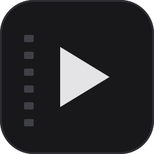
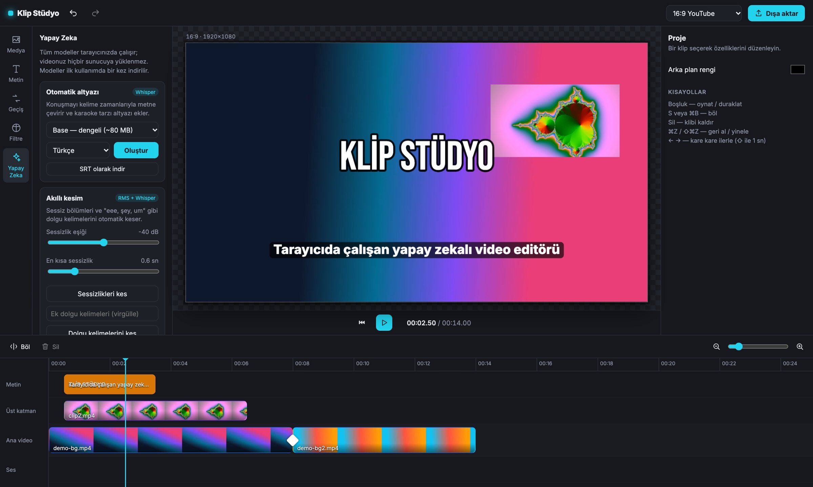
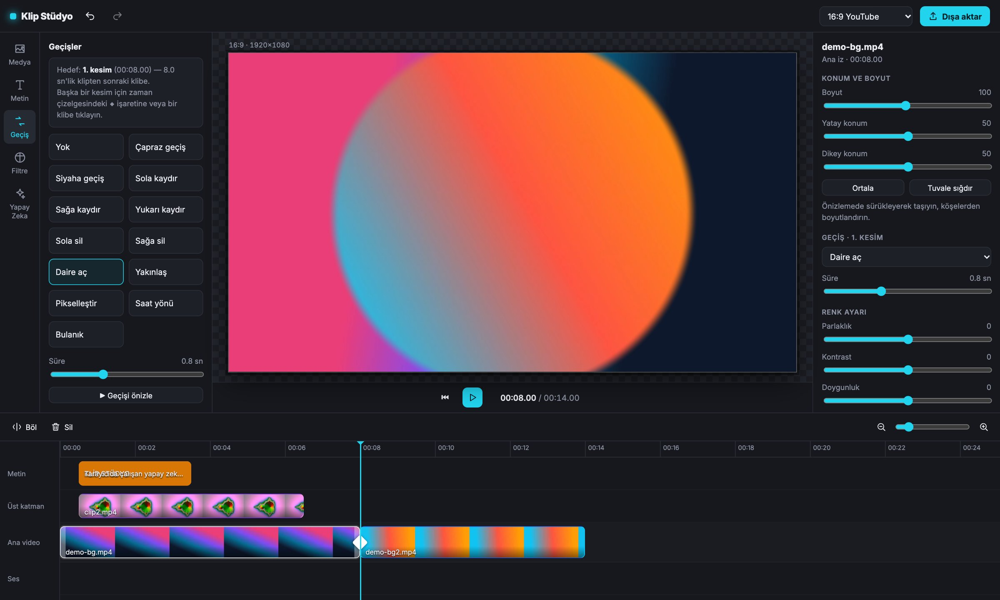

<p align="center">
  
</p>

<h1 align="center">Klip Stüdyo</h1>

<p align="center">
  <b>Tarayıcıda çalışan, yapay zekalı, açık kaynak video editörü.</b><br>
  Zaman çizelgesi, geçişler, filtreler, altyazı, arka plan kaldırma ve nesne silme;<br>
  hepsi tarayıcınızda, yerel olarak. Videonuz hiçbir sunucuya yüklenmez.
</p>

<p align="center">
  
  
  
  
  <a href="https://github.com/YUNUSEMREALSANCAK/klip-studio/actions/workflows/ci.yml"></a>
</p>

<p align="center">
  
  <br>
  <sub>Başlık ve kutulu alt yazı, resim içinde resim üst katmanı ve Yapay Zeka paneli.</sub>
</p>

<p align="center">
  <a href="#özellikler">Özellikler</a> ·
  <a href="#yapay-zeka-tamamen-yerel">Yapay zeka</a> ·
  <a href="#kaputun-altında">Kaputun altında</a> ·
  <a href="#başlarken">Başlarken</a> ·
  <a href="ROADMAP.md">Yol haritası</a> ·
  <a href="AGENTS.md">Katkıcılar ve ajanlar için</a>
</p>

<br>

<table>
  <tr>
    <td width="25%" valign="top">
      <h3>🎬 Tanıdık</h3>
      Medya, Metin, Geçiş, Filtre ve Yapay Zeka sekmeleri; çok izli zaman çizelgesi. Kısa video editörü kullandıysanız Klip Stüdyo'yu zaten biliyorsunuz.
    </td>
    <td width="25%" valign="top">
      <h3>⚡ GPU'da</h3>
      Önizleme ve dışa aktarma WebGL2 shader'larıyla, kodlama WebCodecs ile yapılır. Kurulum yok, sunucu yok, bekleme yok.
    </td>
    <td width="25%" valign="top">
      <h3>🧠 Yerel yapay zeka</h3>
      Whisper, Segment Anything, MediaPipe ve RNNoise tarayıcıda çalışır. Modeller bir kez iner, sonra çevrimdışı da çalışır.
    </td>
    <td width="25%" valign="top">
      <h3>🔓 Açık kaynak</h3>
      MIT veya Apache-2.0. Proje modeli sade JSON; her özelliğin kodu birkaç yüz satırı geçmez.
    </td>
  </tr>
</table>

<br>

## Özellikler

<table>
  <tr>
    <td width="50%" valign="top">
      
      <br>
      <sub>"Daire aç" geçişinin tam ortası; hedef kesim ve süre ayarı.</sub>
      <h3>Geçişler ve renk</h3>
      12 geçiş (çapraz, siyaha, kaydırma, silme, daire, yakınlaşma, pikselleştirme, saat yönü, bulanık), kesimdeki ◆ işaretine tıklayarak eklenir ve otomatik önizlenir.
      <br><br>
      Parlaklık, kontrast, doygunluk, sıcaklık, keskinlik, vinyet ve 9 filtre ön ayarı; hepsi GPU'da, gerçek zamanlı.
    </td>
    <td width="50%" valign="top">
      <h3>Kurgu</h3>
      <ul>
        <li>Dört iz: metin, üst katman, manyetik ana video, ses</li>
        <li>Sürükle-bırak, kenarlardan kırpma, bölme (S), geri al/yinele</li>
        <li>Mıknatıs: oynatma çizgisine, klip kenarlarına ve ritim işaretlerine yapışma</li>
        <li>Önizlemede sürükleyerek taşıma, köşeden boyutlandırma, merkeze yapışma</li>
        <li>16:9, 9:16, 1:1, 4:5 oranları</li>
      </ul>
      <h3>Metin ve altyazı</h3>
      Klasik, kutulu, karaoke, neon ve başlık stilleri; belirme, zıplama, yukarı kayma ve daktilo animasyonları. Altyazılar SRT olarak indirilebilir.
      <h3>Dışa aktarma</h3>
      MP4 (H.264 + AAC), 480p–1080p, 24/30/60 fps. Kare kare render, tarayıcıda kodlama.
    </td>
  </tr>
</table>

## Yapay zeka, tamamen yerel

| Özellik | Ne yapar | Model / yöntem |
| --- | --- | --- |
| Otomatik altyazı | Konuşmayı kelime zamanlarıyla metne çevirir, karaoke altyazı ekler | [Whisper](https://huggingface.co/onnx-community/whisper-base_timestamped) (transformers.js, WebGPU/WASM) |
| Akıllı kesim | Sessizlikleri ve "eee, şey, um" gibi dolgu kelimelerini keser | RMS enerji analizi + Whisper kelime zamanları |
| Arka planı kaldır | Videodaki kişiyi gerçek zamanlı ayırır | MediaPipe Selfie Segmenter |
| Nesne seç ve sil | Tıklanan nesneyi seçer; siler ya da çıkartma olarak keser | [SlimSAM](https://huggingface.co/Xenova/slimsam-77-uniform) + çok ölçekli doldurma |
| Gürültü azaltma | Uğultu ve arka plan gürültüsünü temizler | RNNoise (WebAssembly) |
| Sahne tespiti | Videoyu sahne değişimlerinden böler | Kare farkı analizi |
| Akıllı çerçeveleme | 9:16 için yüzü takip ederek kırpar | MediaPipe Face Detector |
| Otomatik iyileştirme | Parlaklık, kontrast ve doygunluğu dengeler | Görüntü istatistikleri |
| Ritim işaretleri | Müzikteki vuruşları zaman çizelgesine işaretler | Enerji akışı (spectral flux) |

Modeller ilk kullanımda Hugging Face ve Google model deposundan indirilir, tarayıcı önbelleğinde kalır.

## Kaputun altında

```
src/
  core/     Proje modeli (tracks → clips), zaman çizelgesi işlemleri, durum ve geri al
  render/   WebGL2 derleyici, geçiş ve filtre shader'ları, metin çizimi, önizleme motoru
  ai/       Whisper ve SAM worker'ları, ses ve video analiz araçları, MediaPipe
  export/   Kare kare render ve MP4 kodlama (Mediabunny + WebCodecs)
  ui/       React arayüzü
```

- **Tek geometri kaynağı:** önizleme, seçim kutusu ve dışa aktarma aynı `render/layout.ts` hesabını kullanır.
- **Önizleme = dışa aktarma:** ikisi de `render/composeFrame.ts` ile aynı kareyi kurar; yalnızca kare kaynağı değişir (`<video>` ↔ Mediabunny).
- **Ağır işler worker'da:** Whisper ve SAM ayrı Web Worker'larda çalışır, arayüz donmaz.

Ayrıntı: [docs/architecture.md](docs/architecture.md).

## Başlarken

Gereksinimler: Node.js 20.19+ ve güncel bir Chrome veya Edge (WebGL2, WebCodecs; altyazı için WebGPU önerilir).

```bash
git clone https://github.com/YUNUSEMREALSANCAK/klip-studio.git
cd klip-studio
npm install
npm run dev
```

| Komut | Ne yapar |
| --- | --- |
| `npm run dev` | Geliştirme sunucusu |
| `npm run typecheck` | TypeScript tip kontrolü |
| `npm run build` | Üretim derlemesi (`dist/`) |
| `npm run preview` | Derlemeyi yerelde sunar |

### Kısayollar

Boşluk oynat/duraklat · <kbd>S</kbd> böl · <kbd>Sil</kbd> kaldır · <kbd>⌘Z</kbd> / <kbd>⇧⌘Z</kbd> geri al/yinele · <kbd>←</kbd> <kbd>→</kbd> kare kare (<kbd>⇧</kbd> ile 1 sn)

## Yol haritası

Sıradaki adımlar, CapCut'a göre özellik kapsamı ve tahmini süreler [ROADMAP.md](ROADMAP.md) dosyasında.

## Güvenlik

Açıkları herkese açık issue yerine [SECURITY.md](SECURITY.md) içindeki yolla bildirin.

## Lisans ve teşekkür

Klip Stüdyo, [MIT](LICENSE-MIT) veya [Apache-2.0](LICENSE-APACHE) lisanslarından biriyle kullanılabilir.

Kullanılan açık kaynak projeler: [transformers.js](https://github.com/huggingface/transformers.js), [Whisper](https://github.com/openai/whisper), [SlimSAM](https://github.com/czg1225/SlimSAM), [MediaPipe](https://github.com/google-ai-edge/mediapipe), [RNNoise](https://github.com/xiph/rnnoise), [Mediabunny](https://github.com/Vanilagy/mediabunny), [React](https://react.dev), [Zustand](https://github.com/pmndrs/zustand), [Vite](https://vite.dev). Kısa video editörlerinden, özellikle CapCut'ın iş akışından ilham alınmıştır; CapCut kodu veya modeli içermez.
