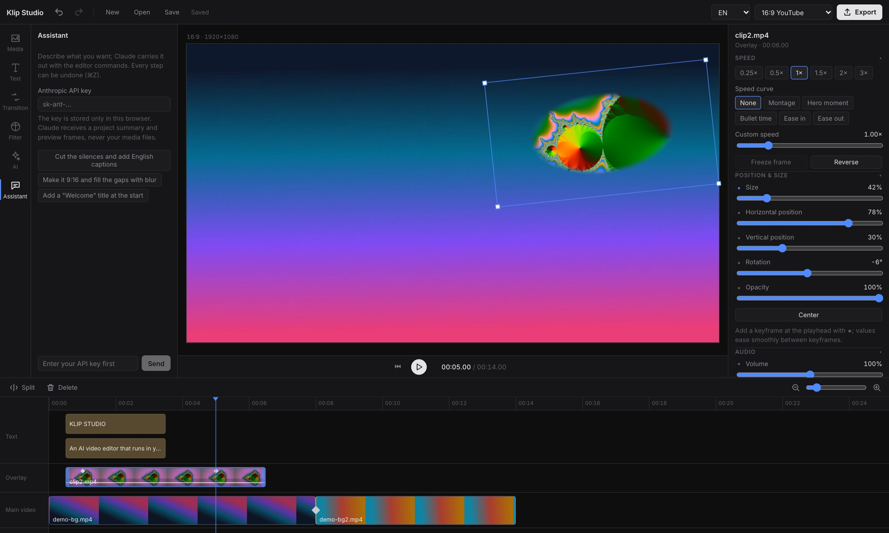

<p align="center">
  
</p>

<h1 align="center">Klip Studio</h1>

<p align="center">
  <b>An open-source, AI-powered video editor that runs entirely in your browser.</b><br>
  Timeline, keyframes, transitions, captions, background removal and object removal,<br>
  all running locally. Your video is never uploaded to a server.
</p>

<p align="center">
  <a href="https://yunusemrealsancak.github.io/klip-studio/"></a>
  
  
  
  
  <a href="https://github.com/YUNUSEMREALSANCAK/klip-studio/actions/workflows/ci.yml"></a>
</p>

<p align="center">
  
  <br>
  <sub>Title and subtitle, elliptical overlay, main track with a transition, and the AI panel.</sub>
</p>

<p align="center">
  <a href="#features">Features</a> ·
  <a href="#local-ai">AI</a> ·
  <a href="#built-for-agents">Agents</a> ·
  <a href="#under-the-hood">Under the hood</a> ·
  <a href="#getting-started">Getting started</a> ·
  <a href="ROADMAP.md">Roadmap</a> ·
  <a href="README.tr.md">Türkçe</a>
</p>

<br>

<table>
  <tr>
    <td width="25%" valign="top">
      <h3>Familiar</h3>
      Media, Text, Transitions, Filters, AI and Assistant tabs over a multi-track timeline. If you've used a short-form video editor, you already know Klip Studio.
    </td>
    <td width="25%" valign="top">
      <h3>On the GPU</h3>
      60 fps preview; a one-minute 1080p video exports in about 10 seconds (Apple M5). WebGL2 for rendering, WebCodecs for encoding.
    </td>
    <td width="25%" valign="top">
      <h3>Local AI</h3>
      Whisper, Segment Anything, BiRefNet, MediaPipe, RNNoise, translation and text-to-speech models all run in the browser.
    </td>
    <td width="25%" valign="top">
      <h3>Agent-ready</h3>
      Every edit is a command: from the UI, the <code>window.klip</code> API, the MCP server, or plain language with Claude.
    </td>
  </tr>
</table>

<br>

## Features

<table>
  <tr>
    <td width="50%" valign="top">
      
      <br>
      <sub>Midpoint of the "Circle open" transition, with target cut and duration.</sub>
      <h3>Transitions, color and effects</h3>
      21 transitions, added by clicking the ◆ marker on a cut and previewed automatically. 13 animated <b>video effects</b> (glitch, shake, VHS, old film, light leak, kaleidoscope…). Brightness, contrast, saturation, temperature, sharpen, vignette, 9 filter presets and <b>.cube LUT</b> import.
      <br><br>
      <b>Crop</b>, <b>blend modes</b> for overlays, shape masks (rectangle, ellipse, linear), <b>chroma key</b>, and a <b>blurred canvas</b> background for vertical video.
      <br><br>
      <b>Custom transitions and filters</b> written in GLSL (gl-transitions compatible), by you or by an AI app over MCP, and <b>custom fonts</b> from a file or Google Fonts.
    </td>
    <td width="50%" valign="top">
      
      <br>
      <sub>Rotated overlay, keyframes and the Assistant panel.</sub>
      <h3>Editing</h3>
      <ul>
        <li>Magnetic main track, automatic lanes for overlapping clips</li>
        <li>Drag and drop, trim, split (S), undo/redo</li>
        <li><b>Keyframes:</b> position, size, rotation, opacity, volume</li>
        <li><b>Speed</b> 0.25×–4× and <b>speed curves</b> (pitch preserved), freeze frame, reverse</li>
        <li>Audio fade in/out, music ducking under speech, <b>voice effects</b> (chipmunk, deep, robot, echo, telephone), 7 synthesized <b>sound effects</b></li>
        <li>10 fonts plus your own, 12 text templates, karaoke captions, outline, shadow and letter spacing</li>
      </ul>
    </td>
  </tr>
</table>

**Projects** autosave to IndexedDB and can be saved and opened as `.klip` files. The app is **installable** (PWA) and opens offline. The UI is available in **English and Turkish**.

## Local AI

| Feature | What it does | Model / method |
| --- | --- | --- |
| Auto captions | Transcribes speech with word timings, adds karaoke captions, exports SRT | [Whisper](https://huggingface.co/onnx-community/whisper-base_timestamped) |
| Caption translation | Translates captions; bilingual captions | [opus-mt](https://huggingface.co/Xenova/opus-mt-tr-en), [NLLB-200](https://huggingface.co/Xenova/nllb-200-distilled-600M) for other languages ¹ |
| Text to speech | Voices text in 11 languages | [MMS-TTS](https://huggingface.co/Xenova/mms-tts-eng) ¹ |
| Smart cut | Removes silences and filler words such as "um" and "uh" | RMS energy + Whisper word timings |
| Remove background (video) | Separates people in real time | MediaPipe Selfie Segmenter |
| Select foreground (image) | One-click cutout of any kind of object | [BiRefNet](https://huggingface.co/onnx-community/BiRefNet_lite-ONNX) (capable GPU) / [MODNet](https://huggingface.co/Xenova/modnet) |
| Select and remove objects | Removes a clicked object from an image or **a whole video** (experimental); fast or high-quality fill | [SlimSAM](https://huggingface.co/Xenova/slimsam-77-uniform) + tracking + [LaMa](https://huggingface.co/Carve/LaMa-ONNX) |
| Isolate an object in video | Tracks any object through a video and removes its background (experimental) | SlimSAM tracking + automatic chroma key |
| Smooth slow motion | Generates AI in-between frames for slowed-down clips | [RIFE 4.22 lite](https://huggingface.co/square-zero-labs/rife-onnx) ² |
| Noise reduction | Cleans up hum and background noise | RNNoise (WebAssembly) |
| Scene detection · Smart reframe · Beats · Auto color | Splits video at scene cuts, follows faces for 9:16, marks beats in music, balances color | Frame differencing · MediaPipe Face Detector · spectral flux · image statistics |

Models are downloaded on first use and stay in the browser cache.
¹ NLLB-200 and MMS-TTS are licensed for non-commercial use only (CC-BY-NC 4.0); check the license before using these two features in a commercial project.
² The RIFE code is MIT-licensed; the repository of the ONNX conversion used does not state a license.

## Built for agents

**Use it from the AI app you already pay for.** Klip Studio includes an MCP server, so Claude Desktop, Claude Code, Cursor, Codex CLI, VS Code, Gemini CLI and other MCP apps can edit your project with your own subscription. No API key needed, and your media stays on your computer.

```bash
claude mcp add klip-studio -- npx -y klip-studio-mcp
```

Then turn on "Agent connection (MCP)" in the Project panel and ask: *"import ~/Movies/vlog.mp4, cut the silences, add captions, make it 9:16 and export it"*. Setup for every app: [docs/mcp.md](docs/mcp.md).

**Describe an effect, get an effect.** Ask for something that isn't built in, like *"a transition where the old clip shatters into glass"* or *"a faded 70s film look with grain"*, and the AI writes it as a GLSL shader, compiles it in the editor, fixes any errors, applies it and checks the result with a screenshot. Custom effects are saved in the project and can be edited in the Transition and Filter tabs.

Under the hood every edit is a typed JSON command (`src/core/commands.ts`), and the same commands run four ways:

| Route | How |
| --- | --- |
| UI | Every button uses the same commands; all of them are undoable |
| Browser API | `await window.klip.execute({ name: 'split', time: 3.2 })`, `window.klip.state()`, `window.klip.screenshot()` |
| MCP server | Tools: `klip_state`, `klip_commands`, `klip_execute`, `klip_screenshot`, `klip_import_file`, `klip_export` |
| Assistant tab | Chat with Claude inside the editor using your own Anthropic API key (stored only in your browser; only a project summary and preview frames are sent) |

## Under the hood

```
src/
  core/     Project model, timeline operations, keyframes, command layer, persistence
  render/   WebGL2 compositor, transition/filter/mask/LUT shaders, text, preview engine
  media/    Import, audio mixing, time-stretch (WSOLA), ducking, reverse, LUT
  ai/       Whisper, SAM and model workers, video object removal, audio/video analysis
  agent/    window.klip API, MCP bridge, Claude assistant
  export/   Frame-by-frame rendering and MP4 encoding (Mediabunny + WebCodecs)
  ui/       React UI
mcp/        MCP server (Node)
```

- **Preview = export:** both build the same frame through `render/composeFrame.ts`.
- **One source of geometry:** preview, selection box and export share `render/layout.ts`.
- **Heavy work in workers:** Whisper, SAM, LaMa, RIFE, translation, text-to-speech and export-time person segmentation run in separate Web Workers.

Details: [docs/architecture.md](docs/architecture.md).

## Getting started

**Try it:** [live demo](https://yunusemrealsancak.github.io/klip-studio/). A recent Chrome or Edge is recommended.

**Run locally** (Node.js 20.19+):

```bash
git clone https://github.com/YUNUSEMREALSANCAK/klip-studio.git
cd klip-studio
npm install
npm run dev
```

| Command | What it does |
| --- | --- |
| `npm run dev` | Development server |
| `npm test` | Unit tests (Vitest) |
| `npm run test:e2e` | End-to-end tests (Playwright); add `--grep @models` to exercise the real models |
| `npm run typecheck` · `npm run build` | Type check · production build |
| `npm run mcp` | MCP server for agents (`--http` for a shared server) |
| `npm run perf` | Performance budget check (needs ffmpeg) |

**Shortcuts:** Space play/pause · <kbd>S</kbd> split · <kbd>Delete</kbd> remove · <kbd>⌘Z</kbd> / <kbd>⇧⌘Z</kbd> undo/redo · <kbd>←</kbd> <kbd>→</kbd> step one frame

## Security

Report vulnerabilities through the process in [SECURITY.md](SECURITY.md) rather than a public issue.

## License and credits

Klip Studio is available under either the [MIT](LICENSE-MIT) or the [Apache-2.0](LICENSE-APACHE) license, at your option. Models are downloaded at runtime under their own licenses (see the notes above).

Built on: [transformers.js](https://github.com/huggingface/transformers.js), [Whisper](https://github.com/openai/whisper), [SlimSAM](https://github.com/czg1225/SlimSAM), [BiRefNet](https://github.com/ZhengPeng7/BiRefNet), [MODNet](https://github.com/ZHKKKe/MODNet), [MediaPipe](https://github.com/google-ai-edge/mediapipe), [RNNoise](https://github.com/xiph/rnnoise), [Mediabunny](https://github.com/Vanilagy/mediabunny), [MCP SDK](https://github.com/modelcontextprotocol/typescript-sdk), [React](https://react.dev), [Zustand](https://github.com/pmndrs/zustand), [Vite](https://vite.dev). Inspired by short-form video editors, especially CapCut's workflow; contains no CapCut code or models.
